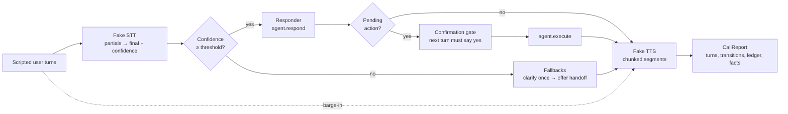

# Voice Agent Runtime

**Problem.** A text agent receives a finished message and returns one. A
voice agent lives in a stream: words arrive incrementally, the caller can
talk over the reply, recognition is sometimes just wrong, and every stage
spends from a latency budget the caller *feels*. Bolting a chat agent onto a
phone line fails on all four.

**Approach.** This repo is the engineering runtime around a voice agent: a
call state machine (LISTENING → THINKING → SPEAKING, with barge-in back to
LISTENING), streaming fake STT/TTS adapters behind production-shaped
interfaces, per-stage latency budgets with a measuring ledger, end-of-turn
detection, confidence fallbacks (clarify → human handoff), and a spoken
confirmation gate for side-effecting actions. Everything runs on an
injectable simulated clock — no audio hardware, fully deterministic.

**Proof.** 91 offline tests; an 8-call scripted scenario suite completes
8/8 tasks with time-to-first-audio p95 of 430 ms against an 800 ms budget,
1/1 successful interruptions, and 10/10 appropriate fallbacks (all numbers
from real runs of the suite, below).

> Synthetic data only. The retailer, its orders and every caller are
> fictional. Independent project, not affiliated with or endorsed by any
> vendor or employer.

## Why voice is a different engineering problem

| Text agents | Voice agents |
|---|---|
| Input arrives complete | Input is a stream of partial transcripts |
| Latency is a metric | Latency is the user interface |
| The user reads the whole reply | The user can interrupt it — and never hears the rest |
| Bad input is visible | Bad input is a confidence score you must act on |
| Confirmation is a button | Confirmation is a spoken turn that can be misheard |

## Architecture



## How it works

1. **Listening.** Partials stream in; end-of-turn detection (silence ×
   linguistic completeness, with a long-silence override) decides the user
   finished; the transcript finalises with a confidence score.
2. **Fallback check.** Confidence below 0.65 never reaches the agent: the
   first low turn gets a clarification, the second consecutive one offers a
   human handoff.
3. **Thinking.** The responder replies — or returns a *pending action*.
   A barge-in here cancels the turn (marked superseded).
4. **Confirmation gate.** Pending actions (the demo: cancelling an order)
   execute only after a separate turn with an explicit spoken "yes".
   "No" rejects; ambiguity re-asks once, then rejects.
5. **Speaking.** The reply is chunked into segments and streamed; the
   ledger records STT-final, time-to-first-audio and end-to-end latencies
   against budget. A barge-in stops playback within 120 simulated ms and
   the unheard remainder is discarded and logged.

## Real run: the scenario suite

`python demos/demo_run.py` (simulated timeline; deterministic):

```text
Voice agent runtime - scripted scenario suite
============================================================
[PASS] clean_order_status: 1 turns, breaches: none
[PASS] barge_in_mid_reply: 2 turns, breaches: none
[PASS] noisy_low_confidence: 2 turns, breaches: none
[PASS] cancel_with_confirmation: 2 turns, breaches: none
[PASS] cancel_rejected_at_confirmation: 2 turns, breaches: none
[PASS] barge_in_during_thinking: 2 turns, breaches: none
[PASS] handoff_request: 1 turns, breaches: none
[PASS] long_reply_budget_breach: 1 turns, breaches: end_to_end 5470ms>1500ms
------------------------------------------------------------
task completion:          8/8 (100%)
time-to-first-audio p95:  430 ms (budget 800 ms)
interruption success:     1/1 (100%)
fallback appropriateness: 10/10 (100%)
total budget breaches:    1
```

The single breach is deliberate: asked for the full returns policy, the
spoken reply takes 5,470 simulated ms end-to-end. No pipeline trick fixes
long content — the production answers are conversational (summarise, offer
the full text in writing). The ledger exists to make that visible per stage.

In the barge-in call, the caller hears the first status segment, interrupts
300 ms into playback, playback stops within 120 ms, and the remaining
segment ("delivery and should arrive today.") is discarded and logged —
the agent never believes it was heard.

## Run it

```bash
python demos/demo_run.py       # scenario suite
python -m pytest tests/        # 91 tests, ~0.3s, stdlib only
python scripts/count_tests.py  # prints the real collected test count
```

## Guardrails and security controls

- **Confirmation before side effects**, enforced by the runtime, not by a
  prompt instruction: the responder cannot execute its own pending actions.
- **Never guess on low confidence** — clarify, then hand off. This applies
  to action requests and confirmations alike.
- **Least-privilege seam**: the responder sees only the final transcript
  and the context the runtime passes; adapters are interfaces, so real
  STT/TTS credentials live outside this code.
- **No secrets, no network, no real data** anywhere in the repo. See
  [SECURITY.md](SECURITY.md).

## Limitations (honest)

- **Simulated everything**: no real audio, microphone, telephony, or
  speech services. Latencies are modelled constants (STT finalise 160 ms,
  think 140 ms, TTS synthesis 130 ms, 60 ms/word speaking rate), chosen to
  be plausible, not measured from a provider.
- The end-of-turn heuristics are simple rules; production uses VAD plus
  learned models. The *contract* (silence × completeness, long-silence
  override) is what carries over.
- The demo responder is rule-based on purpose — an LLM responder plugs
  into the same `respond()` seam, and the gate/budgets/fallbacks wrap it
  unchanged.
- The scenario suite is a small self-written regression set (8 calls), not
  a quality benchmark.

## Built / Written-not-run / Planned

| Status | Item |
|---|---|
| Built | Call state machine with illegal-transition rejection and timestamped transitions |
| Built | Streaming STT/TTS fakes, latency budgets + ledger with percentiles and breach flagging |
| Built | End-of-turn detection; barge-in during SPEAKING (stop + discard accounting) and during THINKING (supersede) |
| Built | Confidence fallbacks (clarify → handoff) and the spoken confirmation gate |
| Built | 8-scenario eval suite with task-completion / TTFA / interruption / fallback metrics; 91 tests |
| Written-not-run | Adapter guidance for real STT/TTS providers (docs/implementation-guide.md) — interfaces specified, no provider integrated |
| Planned | Real audio path (VAD end-of-turn, telephony/WebRTC), PII redaction on transcripts, concurrent sessions and provider rate-limit handling |

## Repository map

- `voice/` — the runtime: `pipeline.py` (state machine), `latency.py`,
  `turns.py`, `fallbacks.py`, `stt.py`, `tts.py`, `agent.py`, `session.py`
- `evaluation/` — `scenarios.py` (8 scripted calls), `metrics.py`
- `knowledge/` — 01 pipeline, 02 latency budgets, 03 barge-in & turns,
  04 architecture
- `docs/` — implementation guide, interview talking points
- `demos/demo_run.py` — the suite run quoted above

## Related work in this portfolio

- `Jagadish-agent-trace-observability` — observing agents in production
  (traces, cost per successful request); this repo covers the real-time
  voice layer those traces would come from.
- `Jagadish-llm-evals-observability` — offline eval metrics; the scenario
  suite here applies the same "metrics from real runs" discipline to voice.
- `Jagadish-agentic-security-layer` — confirmation gates and approvals for
  text agents; the spoken confirmation gate here is that pattern applied
  to voice.
