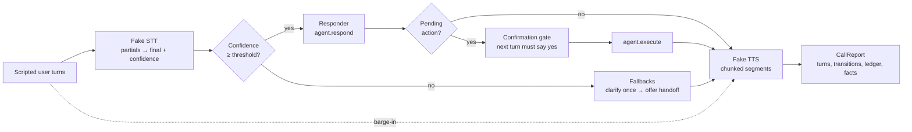
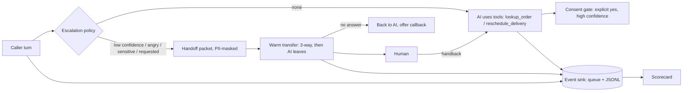

# Voice Agent Runtime

## Recruiter summary

**Problem.** A text agent receives a finished message and returns one. A
voice agent lives in a stream: words arrive incrementally, the caller can
talk over the reply, recognition is sometimes just wrong, and every stage
spends from a latency budget the caller *feels*. Bolting a chat agent onto a
phone line fails on all four.

**Approach.** This repo is the engineering runtime around a voice agent: a
call state machine (LISTENING → THINKING → SPEAKING, with barge-in back to
LISTENING), streaming fake STT/TTS adapters behind production-shaped
interfaces, per-stage latency budgets with a measuring ledger, end-of-turn
detection, confidence fallbacks (clarify → human handoff), and a spoken
confirmation gate for side-effecting actions. Everything runs on an
injectable simulated clock — no audio hardware, fully deterministic.

**AI + human on one call (new).** The agent works the call through mock
MCP-style tools, escalates on low confidence, anger, sensitive topics or a
request, and hands a PII-masked packet to the human over a warm transfer.
Over 300 simulated calls the human asked **0** repeat questions with the
packet versus **722** (4.03 per answered transfer) without it; no call was
dropped; 2,800 analytics events carried 0 raw PII. See
[AI and human working together](#ai-and-human-working-together).

**Proof.** 169 offline tests; an 8-call scripted scenario suite completes
8/8 tasks with time-to-first-audio p95 of 430 ms against an 800 ms budget,
1/1 successful interruptions, and 10/10 appropriate fallbacks (all numbers
from real runs of the suite, below).

> Synthetic data only. The retailer, its orders and every caller are
> fictional. Independent project, not affiliated with or endorsed by any
> vendor or employer.

## Why voice is a different engineering problem

| Text agents | Voice agents |
|---|---|
| Input arrives complete | Input is a stream of partial transcripts |
| Latency is a metric | Latency is the user interface |
| The user reads the whole reply | The user can interrupt it — and never hears the rest |
| Bad input is visible | Bad input is a confidence score you must act on |
| Confirmation is a button | Confirmation is a spoken turn that can be misheard |

## Architecture



## How it works

1. **Listening.** Partials stream in; end-of-turn detection (silence ×
   linguistic completeness, with a long-silence override) decides the user
   finished; the transcript finalises with a confidence score.
2. **Fallback check.** Confidence below 0.65 never reaches the agent: the
   first low turn gets a clarification, the second consecutive one offers a
   human handoff.
3. **Thinking.** The responder replies — or returns a *pending action*.
   A barge-in here cancels the turn (marked superseded).
4. **Confirmation gate.** Pending actions (the demo: cancelling an order)
   execute only after a separate turn with an explicit spoken "yes".
   "No" rejects; ambiguity re-asks once, then rejects.
5. **Speaking.** The reply is chunked into segments and streamed; the
   ledger records STT-final, time-to-first-audio and end-to-end latencies
   against budget. A barge-in stops playback within 120 simulated ms and
   the unheard remainder is discarded and logged.

## Real run: the scenario suite

`python demos/demo_run.py` (simulated timeline; deterministic):

```text
Voice agent runtime - scripted scenario suite
============================================================
[PASS] clean_order_status: 1 turns, breaches: none
[PASS] barge_in_mid_reply: 2 turns, breaches: none
[PASS] noisy_low_confidence: 2 turns, breaches: none
[PASS] cancel_with_confirmation: 2 turns, breaches: none
[PASS] cancel_rejected_at_confirmation: 2 turns, breaches: none
[PASS] barge_in_during_thinking: 2 turns, breaches: none
[PASS] handoff_request: 1 turns, breaches: none
[PASS] long_reply_budget_breach: 1 turns, breaches: end_to_end 5470ms>1500ms
------------------------------------------------------------
task completion:          8/8 (100%)
time-to-first-audio p95:  430 ms (budget 800 ms)
interruption success:     1/1 (100%)
fallback appropriateness: 10/10 (100%)
total budget breaches:    1
```

The single breach is deliberate: asked for the full returns policy, the
spoken reply takes 5,470 simulated ms end-to-end. No pipeline trick fixes
long content — the production answers are conversational (summarise, offer
the full text in writing). The ledger exists to make that visible per stage.

In the barge-in call, the caller hears the first status segment, interrupts
300 ms into playback, playback stops within 120 ms, and the remaining
segment ("delivery and should arrive today.") is discarded and logged —
the agent never believes it was heard.

## Run it

```bash
python demos/demo_run.py       # scenario suite
python -m pytest tests/        # 169 tests, ~0.3s, stdlib only
python demos/handoff_demo.py   # AI+human handoff, events, scorecard
python scripts/count_tests.py  # prints the real collected test count
```

## Guardrails and security controls

- **Confirmation before side effects**, enforced by the runtime, not by a
  prompt instruction: the responder cannot execute its own pending actions.
- **Never guess on low confidence** — clarify, then hand off. This applies
  to action requests and confirmations alike.
- **Least-privilege seam**: the responder sees only the final transcript
  and the context the runtime passes; adapters are interfaces, so real
  STT/TTS credentials live outside this code.
- **No secrets, no network, no real data** anywhere in the repo. See
  [SECURITY.md](SECURITY.md).

## Limitations (honest)

- **Simulated everything**: no real audio, microphone, telephony, or
  speech services. Latencies are modelled constants (STT finalise 160 ms,
  think 140 ms, TTS synthesis 130 ms, 60 ms/word speaking rate), chosen to
  be plausible, not measured from a provider.
- The end-of-turn heuristics are simple rules; production uses VAD plus
  learned models. The *contract* (silence × completeness, long-silence
  override) is what carries over.
- The demo responder is rule-based on purpose — an LLM responder plugs
  into the same `respond()` seam, and the gate/budgets/fallbacks wrap it
  unchanged.
- The scenario suite is a small self-written regression set (8 calls), not
  a quality benchmark.

## Built / Written-not-run / Planned

| Status | Item |
|---|---|
| Built | Call state machine with illegal-transition rejection and timestamped transitions |
| Built | Streaming STT/TTS fakes, latency budgets + ledger with percentiles and breach flagging |
| Built | End-of-turn detection; barge-in during SPEAKING (stop + discard accounting) and during THINKING (supersede) |
| Built | Confidence fallbacks (clarify → handoff) and the spoken confirmation gate |
| Built | 8-scenario eval suite with task-completion / TTFA / interruption / fallback metrics |
| Written-not-run | Adapter guidance for real STT/TTS providers (docs/implementation-guide.md) — interfaces specified, no provider integrated |
| Built | CI: ruff, pytest, README-vs-fresh-run check, hashed brand check, gitleaks (full history); CodeQL; Dependabot; `main` rulesets |
| Built | Mock MCP-style tools (order lookup, reschedule) with schema validation and single-use consent tokens |
| Built | Escalation on low confidence / anger / sensitive topic / request; handoff packet; human handback; warm transfer with no-answer fallback |
| Built | Schema-checked event stream (transcript, sentiment, intent, handoff) to a queue and a JSON-lines file, PII-masked |
| Built | PII masking (Luhn-checked cards, emails, phones, SSNs) for packets, events and logs |
| Built | AI scorecard (resolution, containment, AHT, transfers, cost per resolved call, automation, weighted index) on 300 simulated calls; 169 tests in total |
| Planned | Real telephony transfer (SIP REFER / conference bridge), a real message broker, a learned sentiment model, human-labelled scorecard calibration |
| Planned | Real audio path (VAD end-of-turn, telephony/WebRTC), concurrent sessions and provider rate-limit handling |

## AI and human working together

All of this lives in `contact/` and runs offline on seeded, scripted calls.



1. **Tools during the call.** `contact/tools.py` lists tools the way an MCP
   server does (name, description, JSON-Schema input). Unknown tools,
   missing or extra arguments and wrong types are refused. The reschedule
   tool needs a single-use consent token that only the confirmation gate
   mints, so a "yes, wait, no" or a low-confidence "yes" never moves a
   delivery. An order already out for delivery is refused, and the call is
   counted as not resolved rather than hidden.
2. **Escalation.** `contact/escalation.py` hands off when the caller asks
   for a person, raises a sensitive topic (fraud, bereavement, legal,
   medical), is angry (score below -0.6, or three falling turns ending
   negative), or two turns in a row fall under the confidence floor.
3. **Handoff packet.** Verified identity, intent, entities, actions
   already taken, the open question, the sentiment trend and a masked
   transcript summary (`contact/handoff.py`).
4. **Zero-repeat measurement.** A simulated human asks only for what it
   still needs. Any question about something the caller already gave the AI
   counts as a repeat. The same call is replayed cold (no packet) for the
   comparison.
5. **Handback and warm transfer.** After a fraud check the human hands the
   call back; the AI resumes from the same context and asks nothing again.
   The warm transfer conferences the human in before the AI leg leaves, and
   if nobody answers the caller stays with the AI (a blind transfer baseline
   drops the call in that case — pinned by a test).
6. **Event stream.** `contact/events.py` publishes transcript, sentiment,
   intent and handoff events with a strict envelope
   (`schema_version, event_type, call_id, seq, ts_ms, payload`) to a queue
   and/or a JSON-lines file, masked before any sink sees them.
7. **Scorecard.** `contact/scorecard.py`: resolution and containment rate,
   average handle time, transfers per call, cost per resolved call
   (negative or NaN costs rejected), automation rate (share of actions done
   by the AI), and an index = 100 × (0.40 outcome + 0.25 efficiency +
   0.20 cost + 0.15 automation), each pillar normalised to 0–1.

**Simulated, not measured on real calls.** Handle times and costs come
from constants in `contact/simulation.py` (AI turn 15 s, transfer 40 s,
human question 25 s, human work 120 s; AI $0.02/min, human $1.00/min) and a
90% human-answer rate. The repeat-question and PII numbers are counts of
what the code actually did on these 300 scripted calls; they show the
mechanism works, not how real callers behave.

<!-- run: python demos/handoff_demo.py -->
```text
Simulated calls: 300 (50 per cohort x 6 cohorts, seed 7)
Escalated: 200  (reasons: low_confidence=50, angry=50, sensitive=50, requested=50)
Human did not answer, caller kept with AI: 21
Calls dropped during transfer: 0
------------------------------------------------------------------------
Repeat questions asked by the human (questions about things the caller already said)
  with handoff packet:    0 across 179 answered transfers
  without packet (cold):  722 across 179 answered transfers (4.03 per call)
  AI re-asks after human handback: 0 across 49 handbacks
Events published: 2800, raw PII found in sink payloads: 0
------------------------------------------------------------------------
cohort           resol contain  AHT s  xfer $/resolved  auto  index
order_status      100%    100%     45  0.00      0.015  100%   99.3
reschedule         74%     74%     60  0.00      0.027  100%   88.7
angry_customer     88%      0%    176  1.00      2.011    0%   43.6
sensitive_topic    98%      0%    203  1.00      2.015   67%   55.3
noisy_line         88%      0%    220  1.00      2.845    0%   41.4
asks_for_human     84%      0%    186  1.00      2.018   54%   50.8
ALL (packet)       89%     29%    148  0.67      1.500   62%   64.4
ALL (no packet)    89%     29%    208  0.67      2.631   62%   61.3
```
<!-- /run -->

Reading it: the packet removes every repeat question (0 vs 722), which in
this cost model saves about 60 s of handle time per call on average and
cuts cost per resolved call from $2.63 to $1.50. Containment is low by
design (4 of 6 cohorts are escalation cohorts). The reschedule cohort shows
26% unresolved: those callers asked to move an order already out for
delivery, which the tool correctly refuses.

## Verified numbers (regenerated in CI)

CI re-runs these commands and fails if the blocks below drift
(`python scripts/render_docs.py --check`).

<!-- run: python scripts/count_tests.py -->
```text
169 tests collected
```
<!-- /run -->

<!-- run: python demos/demo_run.py -->
```text
Voice agent runtime - scripted scenario suite
============================================================
[PASS] clean_order_status: 1 turns, breaches: none
[PASS] barge_in_mid_reply: 2 turns, breaches: none
[PASS] noisy_low_confidence: 2 turns, breaches: none
[PASS] cancel_with_confirmation: 2 turns, breaches: none
[PASS] cancel_rejected_at_confirmation: 2 turns, breaches: none
[PASS] barge_in_during_thinking: 2 turns, breaches: none
[PASS] handoff_request: 1 turns, breaches: none
[PASS] long_reply_budget_breach: 1 turns, breaches: end_to_end 5470ms>1500ms
------------------------------------------------------------
task completion:          8/8 (100%)
time-to-first-audio p95:  430 ms (budget 800 ms)
interruption success:     1/1 (100%)
fallback appropriateness: 10/10 (100%)
total budget breaches:    1
```
<!-- /run -->

## Review fixes (portfolio-standard review, 2026-10-22)

Found in an independent review and fixed, each pinned by a test in
`tests/test_review_fixes.py`:

1. **A garbled "yes" executed a cancellation.** The guardrail section
   already promised "never guess on low confidence ... confirmations
   alike", but the confirmation gate ignored STT confidence. A 0.30
   confidence "yes" now re-asks instead of executing.
2. **"Yes, wait, no" was consent.** The gate used `startswith("yes")`, so
   "yes, wait, no", "yes, but don't cancel it" and "yesterday I said no"
   all executed. A yes now needs a word-boundary match and no negation or
   hesitation word anywhere in the reply.
3. **Unknown orders could be "cancelled".** Asking to cancel `CP-9999`
   offered a confirmation and, on yes, recorded a cancellation and said
   "Done". The agent now refuses before the gate, and `execute` refuses
   too (defence in depth).

## Threat model and decisions

- [docs/threat-model.md](docs/threat-model.md) — STRIDE + OWASP LLM Top 10.
- [docs/adr/](docs/adr/) — key design decisions.

## Repository map

- `voice/` — the runtime: `pipeline.py` (state machine), `latency.py`,
  `turns.py`, `fallbacks.py`, `stt.py`, `tts.py`, `agent.py`, `session.py`
- `contact/` — tools, escalation, handoff packet/handback/warm transfer,
  PII masking, event stream, scorecard, seeded simulation
- `evaluation/` — `scenarios.py` (8 scripted calls), `metrics.py`
- `knowledge/` — 01 pipeline, 02 latency budgets, 03 barge-in & turns,
  04 architecture
- `docs/` — implementation guide, interview talking points
- `demos/demo_run.py` — the suite run quoted above

## Related work in this portfolio

- `Jagadish-agent-trace-observability` — observing agents in production
  (traces, cost per successful request); this repo covers the real-time
  voice layer those traces would come from.
- `Jagadish-llm-evals-observability` — offline eval metrics; the scenario
  suite here applies the same "metrics from real runs" discipline to voice.
- `Jagadish-agentic-security-layer` — confirmation gates and approvals for
  text agents; the spoken confirmation gate here is that pattern applied
  to voice.
