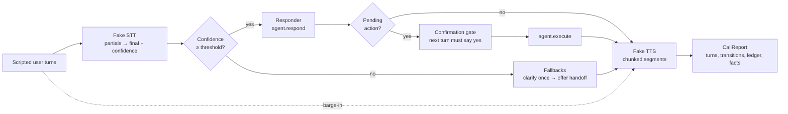

# 04 — Architecture

## Components

| Module | Responsibility |
|---|---|
| `voice/clock.py` | Injectable simulated clock; the single source of time |
| `voice/pipeline.py` | Call state machine, turn processing, barge-in routing, confirmation turns |
| `voice/stt.py` | Fake streaming STT: partials, final transcript + confidence |
| `voice/tts.py` | Fake TTS: sentence chunking, segment durations, stop latency |
| `voice/agent.py` | Pluggable responder; ships a deterministic support agent (fictional retailer) |
| `voice/turns.py` | End-of-turn detection; playback interruption accounting |
| `voice/latency.py` | Per-stage budgets, the latency ledger, percentiles |
| `voice/fallbacks.py` | Confidence policy/tracker; the spoken confirmation gate |
| `voice/session.py` | Run one scripted scenario (or the suite) → `CallReport` |
| `evaluation/scenarios.py` | 8 scripted calls with expected outcome facts |
| `evaluation/metrics.py` | Task completion, TTFA p95, interruption success, fallback appropriateness |

## Data flow

## Key decisions

- **Determinism over realism in the harness.** Injectable clock + scripted
  streams make every number in the README reproducible by re-running the
  suite. Simulated latencies are labelled simulated everywhere.
- **The confirmation gate lives in the runtime, not the agent.** Any
  responder can return a pending action; only the runtime can execute it,
  and only after a separate confirmation turn. A prompt instruction ("ask
  before cancelling") is not a control; this is.
- **Facts, not vibes, for outcomes.** Each scenario declares the fact it
  must produce (`cancelled:CP-1001`, `status_delivered`, `handoff`...).
  Task completion is a set membership check, which keeps the eval honest.
- **Discards are data.** Interrupted speech is logged with its text, because
  "the agent said it" and "the user heard it" are different claims, and only
  one of them is in the report.
